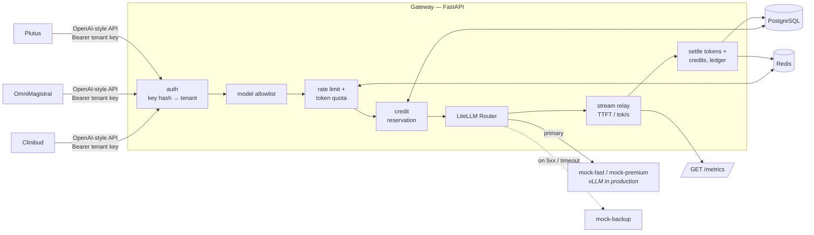

# healthcare-ai-gateway

A **multi-tenant generative-AI gateway** shared by several products, with
per-tenant API keys and model allowlists, **rate limits and token quotas in
Redis**, a **prepaid credit ledger in PostgreSQL**, **routing and fallback with
LiteLLM**, and **streaming metrics** (TTFT, tokens/s, p50/p95) exposed for
Prometheus.

> **Demo, not a production medical system.** All data is synthetic (generated
> by a seeded script). The model backend used for every run in this repo is a
> **mock** OpenAI-compatible server with canned answers and configured
> latencies; it makes no clinical decisions and no model quality is claimed.
> A vLLM configuration is provided but was **not run** (no GPU available).

## The problem

Three products want LLM features at the same time — simulated here as:

| Tenant | Product | Demo use case |
|---|---|---|
| `clinibud` | SaaS for clinics | administrative summary of an appointment |
| `omnimagistral` | compounding pharmacies | structured extraction of an order (JSON, schema-validated) |
| `plutus` | finance | classification of a financial document |

Calling model servers directly from each product means every team rebuilds
keys, limits, billing, retries and monitoring — and nobody can answer "how much
did each product spend?" or "what happens when the GPU server dies?". The
gateway centralises that:

* one **API key per product**, only its **allowed models**;
* **requests/minute** and **tokens/day** limits per product (Redis, atomic);
* **prepaid credits** debited per request by token usage (Postgres, never negative);
* **fallback** to a secondary model when the primary errors or times out;
* **isolation**: a product can never see or spend another product's usage or credits;
* **metrics**: TTFT, decode tokens/s, latency histograms, fallbacks, spend.

## Architecture



## Guided tour

The code is commented for reading. The walkthrough explains each part, in
order, with excerpts and how to run just that part:

1. [Architecture and the life of a request](docs/01-architecture.md)
2. [The mock model backend (and what it is not)](docs/02-mock-backend.md)
3. [Routing and fallback with LiteLLM](docs/03-routing-and-fallback.md)
4. [Tenants, API keys and isolation](docs/04-tenancy-and-isolation.md)
5. [Rate limits and token quotas in Redis](docs/05-quotas-and-rate-limits.md)
6. [Prepaid credits and the usage ledger](docs/06-credits-ledger.md)
7. [Metrics and benchmarks](docs/07-metrics-and-benchmarks.md)
8. [Deployment: Docker Compose, vLLM and CI](docs/08-deployment.md)
9. [Synthetic data and the demo use cases](docs/09-demo-use-cases.md)

Raw benchmark output: [docs/benchmarks.md](docs/benchmarks.md).

## How to run

```bash
docker compose up --build            # gateway :8400, mock :8500, redis, postgres
python -m venv .venv && . .venv/bin/activate && pip install -e ".[dev]"
python scripts/generate_synthetic.py # seeded synthetic inputs -> data/synthetic/
python scripts/demo.py               # one request per tenant, isolation, fallback
```

Tenant keys default to local placeholders (`dev-clinibud-key`, …); override
them via `.env` (see `.env.example`).

Without Docker (how the published tests, demo and benchmarks were actually
run), start any Redis and Postgres, the mock and the gateway as plain
processes — see [docs/08](docs/08-deployment.md#without-docker).

## API examples

The chat endpoint is OpenAI-compatible, so existing OpenAI SDK code only needs
a different `base_url` and `api_key`.

```bash
# Clinibud: administrative appointment summary (streaming)
curl -N localhost:8400/v1/chat/completions \
  -H "Authorization: Bearer dev-clinibud-key" -H "content-type: application/json" \
  -d '{"model":"fast-chat","stream":true,"max_tokens":128,
       "messages":[{"role":"system","content":"[task:clinical_summary] Administrative summary only."},
                   {"role":"user","content":"Synthetic appointment record ..."}]}'

# Own balance and usage (tenant is derived from the key — no tenant parameter exists)
curl -s localhost:8400/v1/credits -H "Authorization: Bearer dev-clinibud-key"
curl -s localhost:8400/v1/usage   -H "Authorization: Bearer dev-clinibud-key"

# Plutus is not allowed to use fast-chat -> 403
curl -s localhost:8400/v1/chat/completions -H "Authorization: Bearer dev-plutus-key" \
  -H "content-type: application/json" -d '{"model":"fast-chat","messages":[{"role":"user","content":"hi"}]}'

# Admin top-up (separate admin secret)
curl -s localhost:8400/admin/credits/topup -H "x-admin-token: dev-admin-token" \
  -H "content-type: application/json" -d '{"tenant":"plutus","amount":500000}'

# Prometheus metrics
curl -s localhost:8400/metrics | grep gateway_
```

```python
from openai import OpenAI

client = OpenAI(base_url="http://localhost:8400/v1", api_key="dev-omnimagistral-key")
r = client.chat.completions.create(model="fast-chat", max_tokens=200, messages=[...])
print(r.choices[0].message.content, r.model)  # r.model = model that actually served
```

Response headers: `x-request-id`, `x-gateway-served-model`, `x-gateway-fallback`.

| Status | Meaning |
|---|---|
| 401 | missing/unknown key |
| 403 | model not in this tenant's allowlist (or unknown) |
| 429 | `rate_limit_error` (RPM) or `quota_exceeded` (daily tokens) |
| 402 | `insufficient_credits` |
| 502 | every model in the fallback chain failed (reservation refunded) |

## Design decisions and trade-offs

* **LiteLLM as a library, not its proxy.** The proxy has its own keys/budgets;
  here the tenancy layer *is* the subject, so it is explicit code. LiteLLM
  provides the backend abstraction, timeouts and fallbacks.
* **Reserve-then-settle for both tokens and credits.** Worst-case amounts are
  reserved atomically (Redis Lua script / conditional `UPDATE … WHERE balance >= x`)
  and corrected after the response. Concurrent requests can never overspend;
  the cost is that a large `max_tokens` temporarily holds more budget.
* **The reservation is a true upper bound** (prompt chars + overhead,
  `max_tokens`, most expensive model in the fallback chain), so settlement only
  refunds and the `CHECK (balance >= 0)` constraint is never hit.
* **Bill the model that actually served.** A fallback is billed at the
  fallback's price.
* **Always stream from the backend**, even for non-streaming clients: one
  billing path and TTFT for every request.
* **No fallback after the first token.** Splicing two models' outputs would be
  worse than a visible error; partial output is billed as delivered.
* **Redis for counters, Postgres for money.** Counters are hot and expiring;
  balances need transactions, constraints and an audit trail.
* **Fixed-window rate limit.** Cheap; allows up to 2× bursts at window
  boundaries. Good enough for a per-product safety limit.
* **Same 403 for unknown and forbidden models**, so tenants cannot enumerate
  other tenants' models.

## Benchmarks

See [docs/benchmarks.md](docs/benchmarks.md) for the commands, hardware and raw
output.

Measured on an Intel i7-1185G7 laptop (4 cores / 8 threads, 39.7 GiB RAM,
Windows 11, Python 3.13), with native Redis and Postgres, against the **mock
backend** (configured 50 ms TTFT, 10 ms/token; 36-token answers). The "direct"
rows are the mock alone; the useful number is what the gateway adds.

| Setup | Concurrency | req/s | TTFT p50 / p95 (ms) | Latency p50 / p95 (ms) |
|---|---:|---:|---:|---:|
| direct to mock | 1 | 1.64 | 61.6 / 64.1 | 607.1 / 635.2 |
| gateway, 1 process | 1 | 1.47 | 77.8 / 87.9 | 678.9 / 731.4 |
| direct to mock | 32 | 45.94 | 62.6 / 193.8 | 617.0 / 751.2 |
| gateway, 1 process | 32 | 10.72 | 1048.7 / 2740.1 | 2634.6 / 4841.8 |
| gateway, 4 workers | 32 | 28.94 | 187.2 / 553.1 | 991.1 / 1521.5 |

* At concurrency 1 the gateway adds **+16 ms TTFT and +72 ms total latency (p50)**.
* **One process is CPU-bound at ~10 req/s**: streaming through LiteLLM cost
  78.9 ms of CPU per request vs 20.8 ms for a bare httpx client (measured).
  Because the gateway is stateless, 4 workers gave 2.7× the throughput.
* Numbers come from a busy development laptop, not a capacity test; no real
  LLM was involved.

## Tests

`pytest` runs 28 tests against **real Redis and Postgres** (a local Redis/Postgres —
containers or native processes, see docs/08 — or GitHub Actions services) and
the mock backend:

* `test_isolation.py` — 401s, per-tenant allowlist, usage/credits visible only
  to their owner, one tenant exhausting its budget or RPM does not affect another;
* `test_quotas.py` — RPM limit, atomic daily token quota under concurrency,
  rejected requests never touch credits;
* `test_chat_and_credits.py` — exact token billing, streaming relay, 402,
  30-way concurrent flood never overspends, admin top-up, `/metrics`;
* `test_fallback.py` — primary 500 → fallback, primary timeout → fallback,
  billing at the served model, all-fail → 502 with full refund, mid-stream
  failure → no fallback and billing of delivered tokens only;
* `test_units.py` — pricing, config validation, auth helpers, mock tokenizer.

## Limitations

* **No real model was run.** All latency/throughput numbers come from the mock
  backend; they measure the gateway plus the mock's configured delays.
* vLLM config and compose profile are written but **untested** (no GPU).
* Token counts for the prompt-side reservation are a character-based upper
  bound, not a real tokenizer; the mock counts words as tokens.
* Fixed-window rate limiting; no per-tenant concurrency limit.
* Schema created with `create_all`, no migrations.
* No mid-stream fallback; no response caching; no request/response logging
  beyond the ledger (deliberately: prompts may contain sensitive data).
* Single-node Redis/Postgres; no HA.
* With several uvicorn workers, each process has its own Prometheus registry,
  so `/metrics` shows only the worker that answered (Prometheus multiprocess
  mode is not configured).
* One gateway process tops out around 10 streamed req/s on the test laptop
  (LiteLLM per-chunk CPU cost); scale with workers/replicas.
* `docker compose up` is verified **in CI on Linux** (the `compose` job builds
  the image, starts the stack and runs `scripts/demo.py` against it), but it
  was **not run on the Windows development machine**: Docker Desktop kept
  failing there (API 500/502, aborted builds). Local tests, demo and
  benchmarks used native processes instead (see docs/benchmarks.md).

## Future work

* Run the same benchmark against a real vLLM server on a GPU (and a CPU
  llama.cpp server) and compare gateway overhead with real decode speeds.
* Real tokenizers per model for tighter reservations.
* Sliding-window limits and per-tenant concurrency caps.
* Alembic migrations; per-tenant monthly invoices from the ledger.
* Grafana dashboard for the Prometheus metrics; OpenTelemetry traces.
* Semantic caching and prompt-level PII redaction before logging.

## License

MIT — see [LICENSE](LICENSE).
