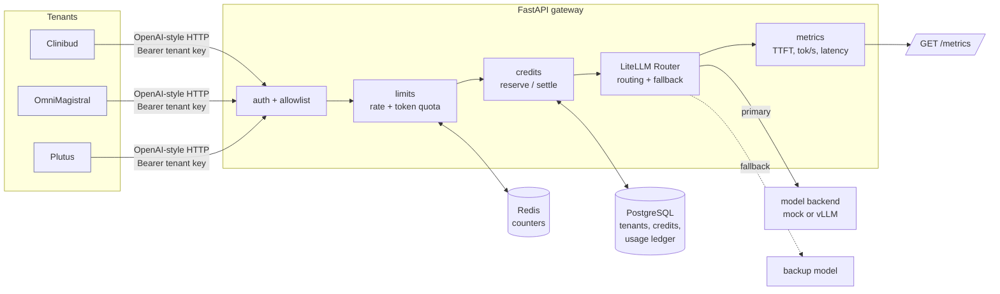

# Part 1 — Architecture and the life of a request

## The problem

Several products want generative AI features at once:

| Tenant (simulated) | Product | Use case in this demo |
|---|---|---|
| `clinibud` | SaaS for clinics | administrative summary of an appointment |
| `omnimagistral` | compounding pharmacies | structured extraction of an order (JSON) |
| `plutus` | finance | classification of a financial document |

If each product called model servers directly, each one would re-implement
keys, limits, billing, retries and monitoring, and nobody could answer "how
much did product X spend this month?" or "what happens when the model server
goes down?". A **gateway** puts all of that in one place:

* products authenticate with their **own API key**;
* each key may only use **its allowed models**;
* each tenant has **rate limits and a daily token quota** (Redis);
* usage is paid from **prepaid credits**, debited by tokens (Postgres ledger);
* if the primary model fails, the request **falls back** to a secondary;
* **metrics** (TTFT, tokens/s, latency) are exposed for Prometheus.

## Components



| Module | Role |
|---|---|
| `gateway/app.py` | HTTP endpoints, app lifecycle |
| `gateway/auth.py` | API key → tenant (the isolation boundary) |
| `gateway/limits.py` | Redis rate limit + atomic token quota |
| `gateway/credits.py` | pricing, credit reservation/settlement, ledger queries |
| `gateway/routing.py` | LiteLLM Router: alias → backend, fallbacks, timeouts |
| `gateway/pipeline.py` | glues the above together for one request |
| `gateway/metrics.py` | Prometheus metrics |
| `gateway/db.py` / `seed.py` | Postgres schema and tenant seeding |
| `mock_backend/server.py` | OpenAI-compatible fake model with configurable latency |

## Life of one request

`gateway/pipeline.py` documents the order of checks at the top of the file:

```text
1. authenticate key            -> 401
2. model in tenant allowlist   -> 403
3. requests-per-minute limit   -> 429   (Redis)
4. reserve daily token quota   -> 429   (Redis, atomic)
5. reserve credits             -> 402   (Postgres, atomic)  [undo 4 on fail]
6. open upstream stream        -> 502 if every model fails  [undo 4 and 5]
7. relay tokens, measure TTFT / throughput
8. settle quota and credits with the real token usage, write the ledger
```

The order is deliberate: cheap checks with no side effects come first, and
nothing that touches money happens until every free check has passed. A 401,
403 or 429 never changes a credit balance (`tests/test_quotas.py::test_rejected_requests_do_not_touch_credits`).

## Why stream from the backend even for non-streaming clients?

`ChatPipeline.complete()` consumes the same stream the streaming endpoint
relays and assembles one JSON body. This gives one code path for billing and
lets the gateway measure **TTFT for every request**, which a non-streaming
upstream call could not.

## How to run just this part

```bash
docker compose up --build
curl -s localhost:8400/health
```

Then read Part 2 to see what is behind the model endpoint.
